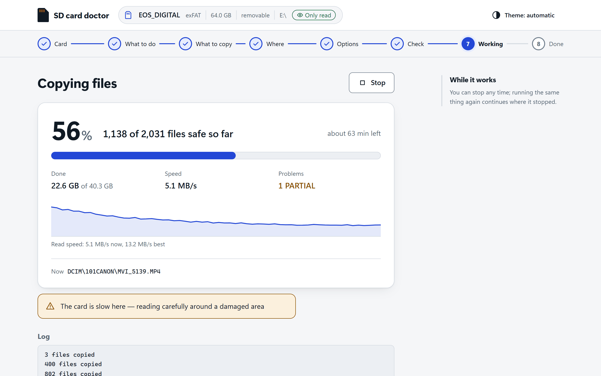
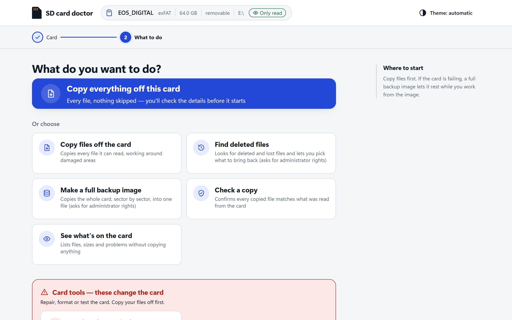
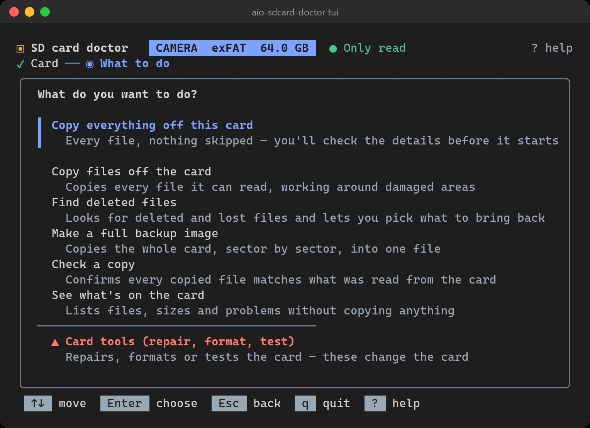
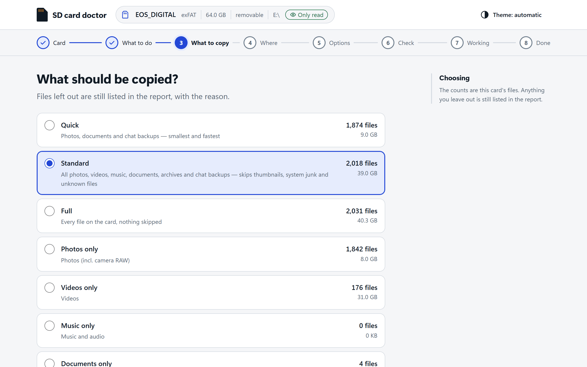
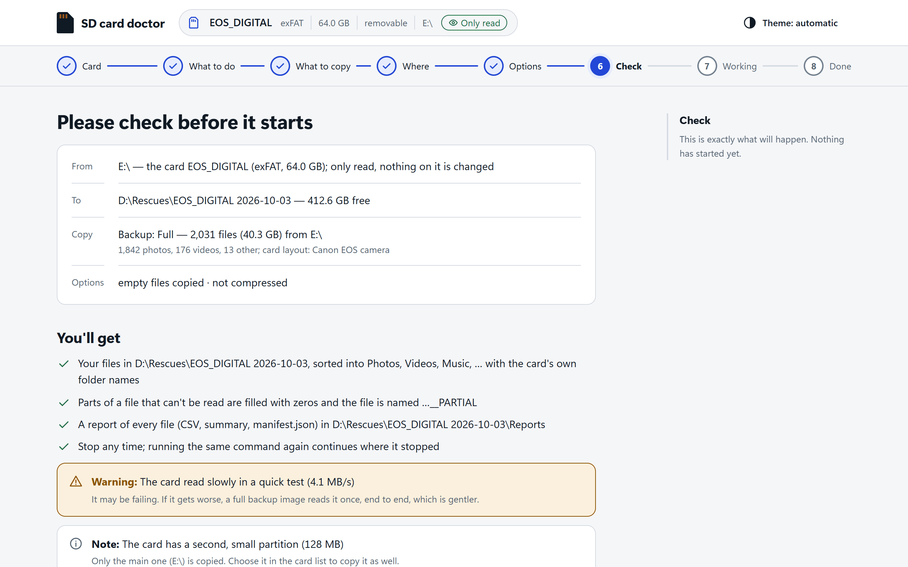
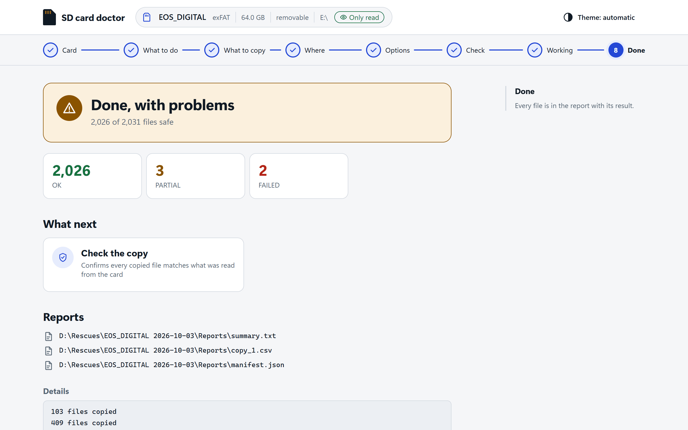
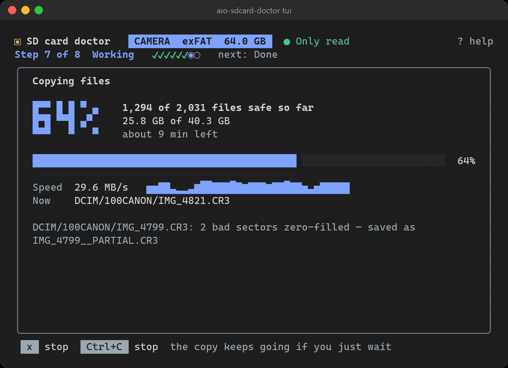
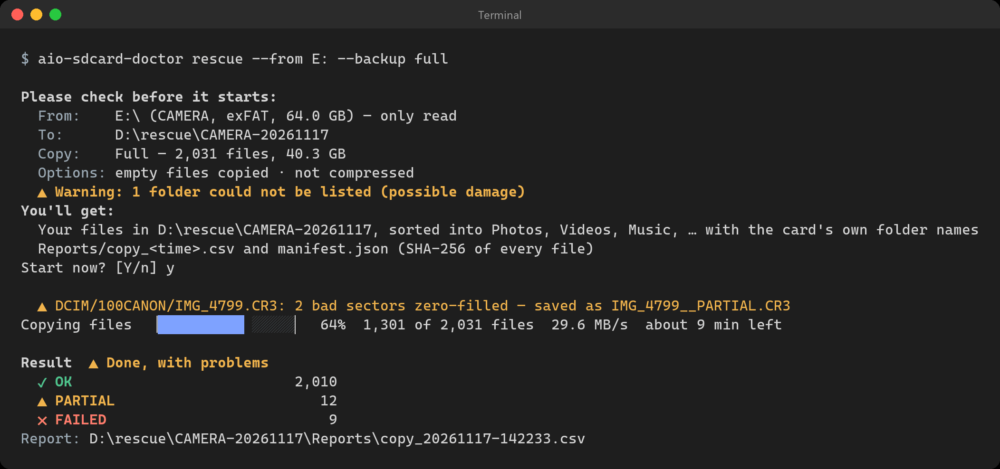

<h1 align="center">AIO SDCard Doctor</h1>

<p align="center"><strong>Get your photos off a failing SD card, safely.</strong><br>
Copy, image, verify, undelete and repair, from a window, a terminal UI or plain commands.<br>
Windows, macOS and Linux. Unpack and run: nothing to install.</p>

<p align="center">
  <a href="https://github.com/hey24sheep/aio-sdcard-doctor/actions/workflows/ci.yml"></a>
  <a href="LICENSE"></a>
</p>

<p align="center">
  <picture>
    <source media="(prefers-color-scheme: dark)" srcset="docs/images/gui-run-dark.png">
    
  </picture>
</p>
<p align="center"><sub>Copying a camera card. The card is only ever read. (A made-up card, for this picture.)</sub></p>

`aio-sdcard-doctor` is one program for SD cards and USB drives from phones, cameras, action cams, drones and other devices. It copies everything it can read off a damaged card, makes a full backup image, checks a copy against the original, finds deleted files the way Recuva does, and carefully repairs, formats or tests a card when you ask it to. It has a window you click through (a local web page only your computer can reach), a keyboard-driven terminal UI, and plain commands for scripts.

## Three ways to use it

<table>
  <tr>
    <th width="50%">The window</th>
    <th width="50%">The terminal UI</th>
  </tr>
  <tr>
    <td>
      <picture>
        <source media="(prefers-color-scheme: dark)" srcset="docs/images/gui-actions-dark.png">
        
      </picture>
    </td>
    <td>
      
    </td>
  </tr>
  <tr>
    <td>On Windows, double-click <code>aio-sdcard-doctor-gui.exe</code>. Anywhere, run <code>aio-sdcard-doctor gui</code>. It opens a local page in your browser that only your computer can reach. It follows your light or dark theme.</td>
    <td>Run <code>aio-sdcard-doctor tui</code>, or the program with no command in a terminal. Everything works from the keyboard. <code>--ascii</code> swaps the symbols (<code>✔ ▲ ✖ █</code>) for plain ASCII, and <code>NO_COLOR</code> turns colour off; every status is also a word.</td>
  </tr>
</table>

Both walk you through the same steps, and nothing starts until you have seen exactly what will happen:

<table>
  <tr>
    <td width="50%">
      <picture>
        <source media="(prefers-color-scheme: dark)" srcset="docs/images/gui-choices-dark.png">
        
      </picture>
    </td>
    <td width="50%">
      <picture>
        <source media="(prefers-color-scheme: dark)" srcset="docs/images/gui-check-dark.png">
        
      </picture>
    </td>
  </tr>
  <tr>
    <td><b>Choose what to copy.</b> The counts and sizes are this card's own. Anything you leave out is still listed in the report, with the reason.</td>
    <td><b>Check, then start.</b> Where it comes from, where it goes, the free space after, and what is left out.</td>
  </tr>
</table>

<table>
  <tr>
    <td width="50%">
      <picture>
        <source media="(prefers-color-scheme: dark)" srcset="docs/images/gui-results-dark.png">
        
      </picture>
    </td>
    <td width="50%">
      
    </td>
  </tr>
  <tr>
    <td><b>See what happened.</b> Every file is in the report with its result; partly read files are named <code>…__PARTIAL</code> and kept.</td>
    <td><b>The same in a terminal.</b> The terminal UI shows the same steps, numbers and questions, from the keyboard.</td>
  </tr>
</table>

Plain commands print the same check and results, with colour and a live progress line on a terminal, and stable plain lines in scripts and logs:

<p align="center">
  
</p>

## Safety promises

- **The card is only ever read.** Our code opens the card read-only. Third-party file-system readers only get a read-only view, so they cannot write either. Only Card tools (check, repair, format, health test) write to a card, and only after you type the card's label and size.
- **You choose what is copied, and nothing is skipped without your choice.** Pick Quick, Standard, Full, one type or one app, or tick everything yourself. Every file on the card is either copied or listed in the report with why it was left out.
- **You see what will happen before it starts.** Every action shows *Please check before it starts* (from, to, free space, what is copied and left out) and *You'll get*, then asks once.
- **Nothing leaves your computer.** Reports stay next to your copy. There is no telemetry. The window is a local page bound to 127.0.0.1, opened with a one-time link.
- **Every action can be stopped and resumed.** Unplug the card, close the window, lose power, unplug the destination disk: run it again and it continues where it stopped (or choose *Start over*). A better copy from an earlier run is never replaced by a worse one.
- **The right card, the right disk.** A resumed run checks it is the same card (serial number, size and a sample of the files already copied). Card tools refuse system disks, the disk holding a rescue or this program, and fixed disks; they check again that the same card is still in the reader just before writing, and warn unless a verified rescue of the whole card exists.

## What it does

| Action (window / terminal UI) | Command | What you get | Needs admin |
|---|---|---|---|
| **See what's on the card** | `scan` | Files and sizes by type and folder, and what could be skipped | no |
| **Copy files off the card** | `rescue` | Every file you chose copied; bad areas retried, then zero-filled and named `…__PARTIAL` | only for an unreadable card or a device |
| **Make a full backup image** | `image` | `card.img` with a GNU ddrescue-compatible mapfile; resumable | yes |
| **Check a copy** | `verify` | Every copied file re-hashed against the SHA-256 recorded when it was read | no |
| **Find deleted files** | `recover` | A Recuva-style list (Excellent / Poor / Unrecoverable); you tick what comes back | yes |
| **Card tools** | `fix` | Check, repair or format with your OS's own tools; a health test that finds bad areas and fake-capacity cards | yes |

### Pick the card, check, then start

- **Which drive?** Cards and USB drives are listed first; system drives are hidden until you ask. If no card is connected it says so and keeps looking; you can also use an internal drive, a folder or a card image file.
- **Check before it starts.** Warnings must be accepted, anything that blocks the action stops it, and Card tools need the label and size typed in. Scripts confirm with `--yes` (and `--confirm-label`/`--confirm-size` for Card tools).
- **Internal drives are fine too.** Copying between two internal drives on the same disk only shows a warning; a card is never copied onto itself.

### Choose what to copy

The first question is what to back up. Each choice shows how many files and GB it would copy from your card:

| Choice | Copies |
|---|---|
| **Quick** | Photos, documents and chat backups: smallest and fastest |
| **Standard** | All photos, videos, music, documents, archives and chat backups; skips thumbnails, system junk and unknown files |
| **Full** | Every file on the card, nothing skipped |
| **Photos / Videos / Music / Documents only** | Just that type; skips thumbnails and system junk |
| **WhatsApp only / Telegram only** | That app's photos, videos, voice notes, documents (and WhatsApp chat backups) |
| **Custom** (command line) | You tick each type, app and skip suggestion |

Two more ticks for any choice: **leave out empty (0-byte) files** and **compress**. In the window, *Copy everything off this card* is the quick path: Full, into a folder in your home folder, and you still check it before it starts.

**Skip suggestions** are only suggestions. Nothing is skipped unless you choose it, and skipped files are still listed in the report:

| ID | What | Recommended |
|---|---|---|
| `thumbnails` | Gallery thumbnail caches, rebuilt by the phone | yes |
| `system-folders` | OS bookkeeping, not your files | yes |
| `mac-metadata` | macOS `._*` resource-fork stubs | yes |
| `camera-cache` | Camera index caches | yes |
| `android-app-data` | `Android/data`, `obb`: app caches, usually re-downloadable, but can hold app downloads | no |
| `chkdsk-fragments` | `FOUND.000` pieces recovered by chkdsk; may contain photos | no |

### Card layouts it understands

Android phones (DCIM, WhatsApp backups, LOST.DIR), DCF cameras, AVCHD and Sony XAVC video, GoPro, DJI, Insta360, and any generic card. Layout rules only suggest; they never hide files.

### File systems and what each allows

| File system | Read files | Find deleted files with names | Skip live files in deep scan |
|---|---|---|---|
| FAT12/16/32 | yes | yes | yes |
| exFAT | yes | yes | yes |
| NTFS | yes | not yet — use Deep scan | not yet |
| ext2/3/4 (checked against real ext4 images) | yes | no: ext4 wipes deleted file locations | not yet |
| ISO9660 | yes | no: read-only disc format | not yet |
| APFS, HFS+, encrypted | through the OS mount | no | no |

Deep scan and full images work on any card, whatever its file system. Anything a card or your OS can't do is shown greyed out with the reason, never hidden. For Card tools:

| | Windows | macOS | Linux |
|---|---|---|---|
| Check / repair | `chkdsk` (FAT, exFAT, NTFS) | `diskutil` (FAT, exFAT); NTFS: no tool; HFS+/APFS: use Disk Utility | `fsck.vfat` (dosfstools), `fsck.exfat` (exfatprogs), `e2fsck`; NTFS: use Windows |
| Format | `format` (FAT32 up to 32 GB, else exFAT) | `diskutil eraseVolume` | `mkfs.vfat` / `mkfs.exfat` (card unmounted) |
| Health test | yes | yes | yes (card unmounted) |

### Deep scan formats

Found by their signatures in free space and sized by walking their structure (our own engine; contiguous files only):

- **Photos:** JPEG, PNG, GIF, BMP, WebP, TIFF and camera RAW (CR2, NEF, ARW, DNG, PEF, ORF, RW2, SRW, RAF), HEIC/AVIF, CR3
- **Video:** MP4, MOV, 3GP, M4V, INSV, MKV/WebM, MPEG-TS/M2TS, MPEG-PS (MPG, VOB, MOD, TOD), AVI, FLV, WMV
- **Audio:** MP3, AAC, AMR, FLAC, Ogg/Opus, WAV, AIFF, MIDI, M4A
- **Documents and archives:** PDF, ZIP family (DOCX, XLSX, PPTX, ODT, ODS, ODP, EPUB, APK), 7z, RAR 4/5, GZIP, SQLite (incl. unencrypted WhatsApp databases), DOC/XLS/PPT, RTF

Not findable by signature: encrypted WhatsApp backups (`.crypt12/14/15`, no recognisable header), pro video (MXF, BRAW, R3D), and plain text/CSV/VCF (no header).

## Install

Download the archive for your system from the [releases page](https://github.com/hey24sheep/aio-sdcard-doctor/releases), check it, and unpack it (each archive unpacks into its own folder).

- **Check the download:** compare its SHA-256 with `checksums.txt` (`certutil -hashfile file.zip SHA256` on Windows, `shasum -a 256 file.tar.gz` on macOS, `sha256sum file.tar.gz` on Linux). Every release file also carries a signed build-provenance attestation, so with the GitHub CLI you can check it was built from this repository by its release workflow: `gh attestation verify <file> --repo hey24sheep/aio-sdcard-doctor`. Each archive has an SBOM (`….sbom.json`) listing everything inside it.
- **Windows:** the binaries are not code-signed yet, so SmartScreen may warn. After checking the hash, unblock the downloaded zip before unpacking it (`Unblock-File .\aio-sdcard-doctor_*.zip` in PowerShell, or Properties → Unblock), so both programs inside are trusted; or choose *More info → Run anyway* when it warns. `aio-sdcard-doctor-gui.exe` opens the window directly (no console).
- **macOS:** remove the download quarantine after checking the hash: `xattr -d com.apple.quarantine ./aio-sdcard-doctor`.
- **Linux:** `.deb` and `.rpm` packages are also built.
- **From source:** with Go 1.26 or newer, `go install github.com/hey24sheep/aio-sdcard-doctor/cmd/aio-sdcard-doctor@latest` (no C compiler needed).

## Usage

Run it without a command: on Windows, double-clicked it opens the window; in a terminal it opens the terminal UI (on macOS, double-clicking it in Finder opens a terminal, so you get the terminal UI); and in a script (or with `--plain`) it lists the drives and these commands. Screen-reader users: the plain commands (`--plain`) give line output with no screen redraws.

```
aio-sdcard-doctor scan    --from E: [--to DIR]
aio-sdcard-doctor rescue  --from E: [--to D:\rescue] --backup quick|standard|full|photos|videos|music|documents|whatsapp|telegram|custom
                          [--types … --exclude … --apps …] [--skip-empty] [--compress] [--start-over] [--raw] [--yes]
aio-sdcard-doctor image   --from E: --to D:\card.img [--retry-passes 0-5] [--compress [--keep-raw]] [--yes]
aio-sdcard-doctor verify  --manifest D:\rescue\Reports\manifest.json [--target F:] [--restart] [--yes]
aio-sdcard-doctor verify  --image D:\card.img
aio-sdcard-doctor recover --from E: --to D:\recovered [--deep [--thorough]] [--list] [--select picks.csv]
                          [--types …] [--min-size 20KB] [--states excellent,poor] [--skip-rescued MANIFEST] [--flat] [--compress] [--yes]
aio-sdcard-doctor fix     --drive E: --check|--repair|--format|--health-test [--allow-fixed] [--manifest MANIFEST]
                          [--label NAME] [--new-test] [--no-replug] [--confirm-label L --confirm-size "64.0 GB"] [--yes]
aio-sdcard-doctor gui     [--no-open] [--port N]
aio-sdcard-doctor tui     [--ascii] [--no-animation] [--no-bell]
```

`--from` takes a drive (`E:`), a device (`\\.\PhysicalDrive2`, `/dev/sdb`, `/dev/disk4`) or a card image file; `scan` and `rescue` also take a folder, and `image` takes only a drive or device. Without `--to`, `rescue` copies into `./aio-sdcard-doctor-<label>-<date>`. Run any command with `--help` for every flag. Exit codes: 0 ok, 1 error, 2 usage, 3 finished with partial/failed files, 4 needs admin, 130 interrupted.

**Find deleted files** in two steps if you like: `--list` writes the results list as a CSV (State, Name, Path, Size, Modified, Comment, ID); keep the lines you want and pass the file to `--select`.

**Images** are ddrescue-compatible: `card.img.map` is a GNU ddrescue mapfile, so `ddrescue` can continue or inspect the image, and `card.img.json` records the card's identity and hashes for `verify --image`. Copy files out of an image with `rescue --from card.img` or `recover --from card.img`, without the card.

**Compressed output** opens with tools you already have: ZIP parts (`Photos-0001.zip`, …) with Explorer, Finder, `unzip` or 7-Zip; `card.img.xz` with 7-Zip on Windows, `xz -d` / `unxz` on macOS and Linux.

**Administrator rights** are asked for only when needed (images, unreadable cards, finding deleted files on a device, Card tools). On a terminal it offers to restart elevated; a script gets the exact command to run and exit code 4. The window shows the command to run as administrator. Files created while elevated are given back to your user on macOS and Linux.

## Honest limits

- A reader process stuck on a dying card may linger until the card answers or is unplugged; the app itself never hangs.
- Mounting a card lets the OS write small bookkeeping files to it, and it may update each file's last-access date as it is read. Slide the card's lock switch before inserting it, or read the card directly (`--raw`).
- Post-write checks read through the OS cache. Run Verify after re-plugging for a full check.
- Scan and Card tools check/repair/format are not resumable (running them again is the resume). Everything else resumes.
- A compressed (ZIP) copy resumes by whole ZIP parts: if it stops, the part being written (up to 1,000 files or 1 GiB) is dropped and those files are read from the card again. On a failing card, leave compression off.
- An image stores a sector it couldn't read as zeros. Read from the image, a folder that lost its last listed sector looks complete, so files listed only there are not noticed as missing; the image's `.map` file records where those sectors are. Copying from the card itself reports such a folder.
- Deep scan recovers contiguous files only. Fragmented files are listed with their offset and reason, not written.
- Finding deleted files with names works on FAT and exFAT cards. NTFS cards get deep scan only for now.
- Recovered files are checked before they are written: photos are decoded, and every file's structure must hold together to its end. What sits inside a valid structure (video frames, RAW pixels) is not decoded, so a "Poor" file can still come back partly wrong; the report marks those.
- Deleted files can only come back while their space has not been reused. Damaged ones are not written; the report lists their path and reason.
- Compression saves almost nothing on photos and videos; it helps documents, RAW, WAV and images with empty space. Compressing an image needs room for the raw image and the `.xz` until the `.xz` is verified.
- APFS/HFS+ are readable only when the OS mounts them.
- Card tools on real hardware for macOS/Linux are tested against image files only.
- Card tools refuse a disk holding a rescue only while that disk is mounted. On Linux and macOS a card must be unmounted for repair, format and the health test; on Linux the window and terminal UI then grey these out and show the exact `umount` and `fix --drive` commands to run, so check you named the right card: you type its label and size to confirm.
- The window can't restart itself as administrator yet; it shows the command to run. It has no preview images or image block map yet (the command line has everything else).
- A resumed copy treats file times that differ by a whole number of quarter hours (up to 14 h) as the same, because readers disagree about time zones on FAT and exFAT cards. A file edited at exactly such an interval with the same size is not copied again.

## Roadmap

- [x] Scan with card-layout profiles and skip suggestions
- [x] Rescue with backup choices, bad-sector salvage, resume and verify-after-write
- [x] Compressed output (ZIP parts / `.img.xz`)
- [x] Full backup image with ddrescue-compatible mapfile
- [x] Verify a copy or new card
- [x] Built-in read-only parsers: FAT, exFAT, NTFS, ext4, ISO9660, MBR/GPT (checked in tests against images made by the real `mkfs` tools)
- [x] Isolated reader process (stall/crash recovery, memory cap)
- [x] Find deleted files: undelete on FAT and exFAT, deep scan for 28 format families with our own carver
- [x] Card tools: check / repair / format with the OS's own tools, resumable health test (bad areas, fake capacity)
- [x] Terminal UI
- [x] Local web window
- [ ] NTFS undelete, preview images and the image block map in the window, restarting the window as administrator
- [ ] Signed releases for Windows and macOS

## Disclaimer

Use this software at your own risk. It is provided "as is", without warranty of any kind, as the MIT licence states.

- **No recovery is guaranteed.** A failing card can get worse or stop working at any moment, even while it is only being read. If the data matters a lot, consider a professional data-recovery service before trying any software.
- **Card tools can erase data.** Repair, format and the health test write to the card, and format and the health test erase it. Run them only after your files are copied off and checked, and only on the card you mean to change.
- **Check the result yourself.** Run Verify on your copy and open your important files before you format, reuse or throw away the original card.
- **The authors are not liable** for lost or damaged data, damaged hardware, or any other loss from using this software.
- **No affiliation.** Recuva, GNU ddrescue, 7-Zip and the other products and companies named here belong to their owners. This project is not affiliated with or endorsed by any of them, or by any card or device maker.

## Licence

MIT. Every library compiled into the program uses a permissive licence (MIT, BSD, Apache-2.0, ISC, Zlib, 0BSD or Unlicense); `scripts/notices.sh` checks this on every CI run and before every release build, and each release ships `THIRD_PARTY_NOTICES.txt`. The OS's own tools (`chkdsk`, `format`, `diskutil`, `fsck`, `mkfs`) are called, never bundled.

Third-party libraries: go-diskfs, libxfat, go-ntfs (Velocidex), go-ext4-filesystem, go-mp4, mimetype, bbolt, backoff, cobra/pflag, klauspost/compress, ulikunitz/xz, x/image, x/sys, x/term, x/text, Bubble Tea, Lip Gloss and the Charm terminal libraries, termenv, go-runewidth, uniseg, and their dependencies — `THIRD_PARTY_NOTICES.txt` holds every one's full licence text (and the Go standard library's). Linux packages install it in `/usr/share/doc/aio-sdcard-doctor/`.
